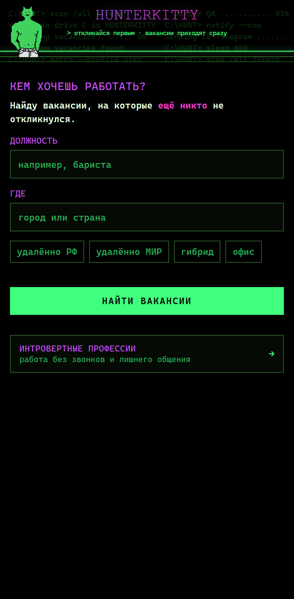
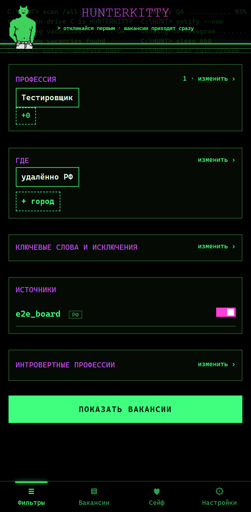
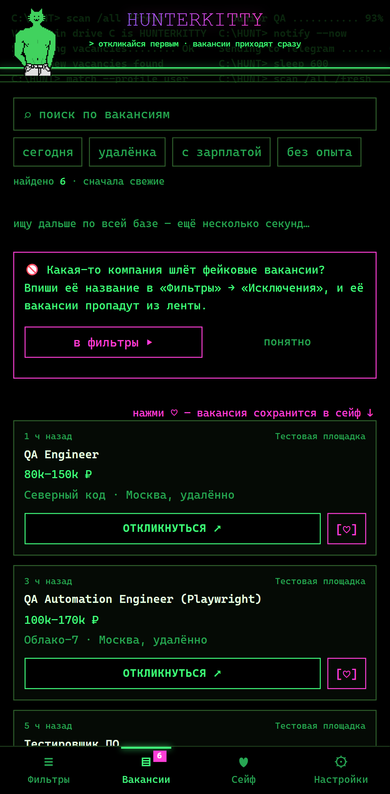
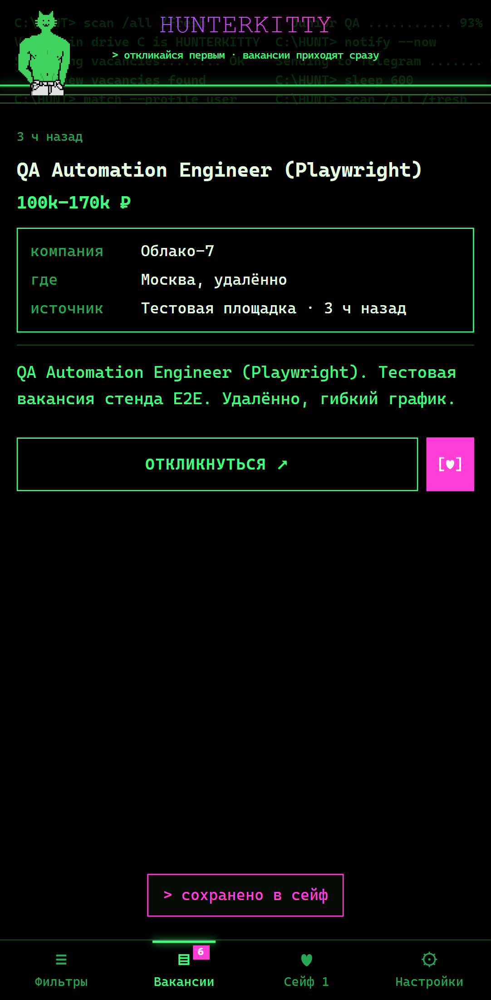
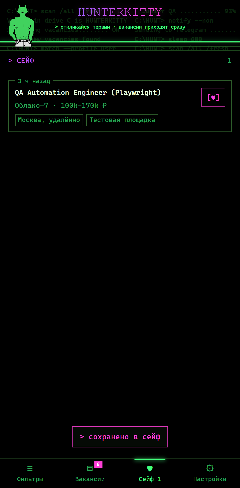

# HunterKitty Work: E2E и API автотесты Telegram Mini App

**QA Engineer: Sony Fridmo**

Автотесты для моего продукта [HunterKitty Work](https://t.me/Jobradar_kittybot): Telegram-бот и Mini App для поиска работы.
Mini App в основном открывают с телефона, поэтому E2E-тесты идут в эмуляции Android-устройств.

**Стек:** Playwright, JavaScript, Page Object, фикстуры, эмуляция Pixel 7 и Galaxy S9+, HTML-отчёт, видео, скриншоты и трейс при падении.

**Результат: 39 тестов, все зелёные** (13 API + 13 E2E × 2 устройства).

<p>





</p>

## Что проверяется

### E2E: путь пользователя (Pixel 7, Galaxy S9+)
| Сценарий | Что проверяю |
|---|---|
| Онбординг новичка | ввёл профессию, выбрал формат «удалённо РФ», нажал «Найти» и сразу видит только подходящие вакансии |
| Онбординг без профессии | кнопка поиска не запускает поиск, остаёмся на онбординге |
| Лента | только вакансии по профессии и формату из фильтров, счётчик совпадает с числом карточек |
| Поиск по ленте | «playwright» оставляет одну вакансию, очистка поля возвращает все |
| Карточка вакансии | название, зарплата, компания, описание |
| «Откликнуться» | ссылка на вакансию открывается через Telegram (`openLink`) |
| Ошибка сервера | при 500 на поиске показывается понятное сообщение, навигация работает |
| Сейф ♥ | сохранение, вакансия на месте после перезапуска, удаление из ленты и из сейфа, пустое состояние |
| Вход не из Telegram, без /start, отключённый пользователь | понятное сообщение вместо приложения |

### API: авторизация и доступ к данным
| Проверка | Ожидание |
|---|---|
| Валидная подпись initData | 200 |
| Нет заголовка / подпись чужим токеном / подмена id пользователя в подписанной строке | 401 |
| Подпись старше суток / дата из будущего | 401 |
| Не нажимал /start / отключённый пользователь | 403 |
| Выдача совпадает с фильтрами, без профессии поиск не запускается | 200 / 400 `no_title` |
| Сейф: сохранить и убрать | 200, список сейфа меняется |
| **IDOR:** чужую вакансию из выдачи нельзя открыть или сохранить | 404 |

### API: безопасность ([access.spec.js](tests/api/access.spec.js), [sqli.spec.js](tests/api/sqli.spec.js))
| Проверка | Ожидание |
|---|---|
| Все 33 маршрута API без подписи / отключённый пользователь / не нажимал /start | 401 / 403 / 403 |
| Чужая строка выдачи: открыть, перейти, сохранить, письмо; чужой или несуществующий счёт | 404 |
| Кривой JSON и массив вместо объекта на 10 маршрутах с телом | 400, не 500 |
| Недопустимые поля и значения (`is_admin`, неизвестный режим, пустая профессия) | 400 |
| Нечисловой id в адресе (`1 OR 1=1`) | 404, до обработчика не доходит |
| SQL injection через профессии, стоп-слова, компании, навыки, города, `offset` | сохраняется как текст, таблицы целы, чужая выдача не меняется |
| Time-based инъекция (`pg_sleep`) | не исполняется |
| Повтор той же initData в пределах суток | принимается: известный принятый риск, разбор в [hunterkitty-security-review](https://github.com/sonyfrid/hunterkitty-security-review) (HK-11) |

## Как устроено

- **Авторизация как в Telegram.** Тесты сами подписывают `initData` (HMAC-SHA256 от токена бота, [как в документации Telegram](https://core.telegram.org/bots/webapps#validating-data-received-via-the-mini-app)). Скрипт `telegram-web-app.js` подменяется заглушкой с тем же интерфейсом `window.Telegram.WebApp`, вызовы `openLink` записываются, и тест их проверяет.
- **Изолированный стенд.** Стенд поднимает тот же сервер Mini App, что в проде, на отдельной локальной базе Postgres с тестовыми вакансиями и пользователями. Токен бота фейковый: в Telegram и на сайты вакансий не уходит ни одного запроса.
- **Чистые данные.** Перед каждым тестом база пересоздаётся (служебный `POST /__e2e/reset`, есть только на стенде), поэтому тесты не зависят друг от друга и от порядка запуска.
- **Данные через API, проверки через интерфейс.** Подготовка состояния идёт запросами, а UI проверяется там, где это видит пользователь.
- **Без sleep.** Только автоожидания `expect` и `expect.poll`.

```
├── fixtures/index.js      # фикстуры: api (подписанные запросы, сброс базы), openApp (вход «из Telegram»), страницы
├── pages/                 # Page Object: Onboarding, Filters, Feed, Detail, Safe
├── support/telegram.js    # подпись initData и заглушка Telegram WebApp
├── support/users.js       # тестовые пользователи стенда
├── tests/api/             # авторизация, лента, сейф, IDOR
├── tests/e2e/             # онбординг, лента, карточка, отклик, ошибки, сейф
└── stand/                 # описание стенда (код стенда закрыт вместе с продуктом)
```

## Запуск

Код продукта и стенда закрыт, поэтому тесты запускаются у меня локально. Ниже команды запуска, а отчёт и скриншоты прогона в папке `docs`.

```bash
npm install
npx playwright install chromium
npm test                 # всё: API + E2E на двух устройствах
npm run test:api         # только API
npm run test:e2e         # только E2E
npm run report           # HTML-отчёт с видео и трейсами упавших тестов
```

Playwright сам запускает стенд перед тестами (`webServer` в `playwright.config.js`), адрес стенда можно задать через `STAND_URL`.
